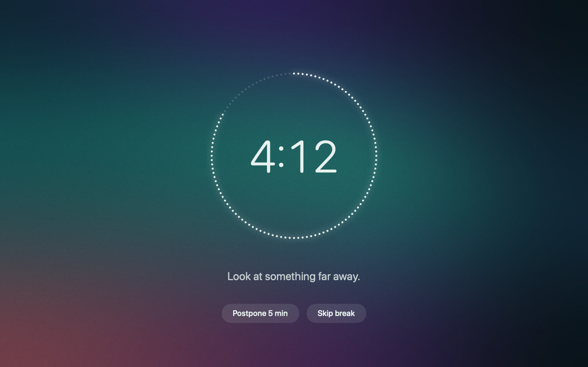

# Breather

A Mac menu bar app that makes you take a break. Every 50 minutes it covers every screen with a calm, slowly moving gradient and a dotted ring that counts down a 5-minute break. When the break is over, the screen fades away and the next 50 minutes start.



There is one kind of break. No short and long breaks, no Pomodoro.

## Using it

- **Esc** or **Postpone 5 min** hides the break and brings it back in 5 minutes.
- **Skip break** starts a new 50-minute work cycle.
- The menu bar icon is a small ring of 12 dots. The lit dots show how much of the work cycle is left.
- The menu has **Take a Break Now**, **Restart Work Cycle**, **Pause for 1 Hour** and **Pause Until Tomorrow**.
- **Settings** sets the work and break lengths and turns on **Open Breather at login**.
- Time away from the Mac counts as a break if it lasts at least as long as one: lunch, a locked screen or a sleeping Mac start a fresh cycle when you come back.

## Build

```sh
brew install xcodegen
./scripts/build.sh            # Debug build into build/
./scripts/install.sh          # Release build into ~/Applications, then starts it
```

Or run `xcodegen generate` and open `Breather.xcodeproj`.

Open at login uses `SMAppService`, so it works best from the copy in `~/Applications`.

The timing rules live in the `BreatherCore` package. Run its tests with `swift test --package-path Packages/BreatherCore`.

Debug builds take two launch arguments:

- `-BreatherBreakNow YES` starts a break a second after launch.
- `-BreatherSnapshot <folder>` renders the break screen and settings to PNGs, then quits.
